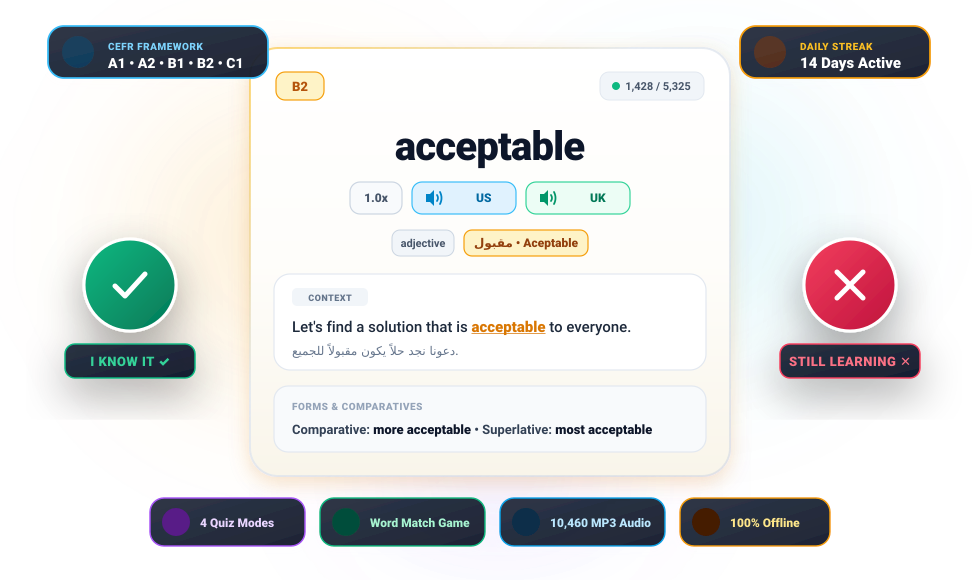
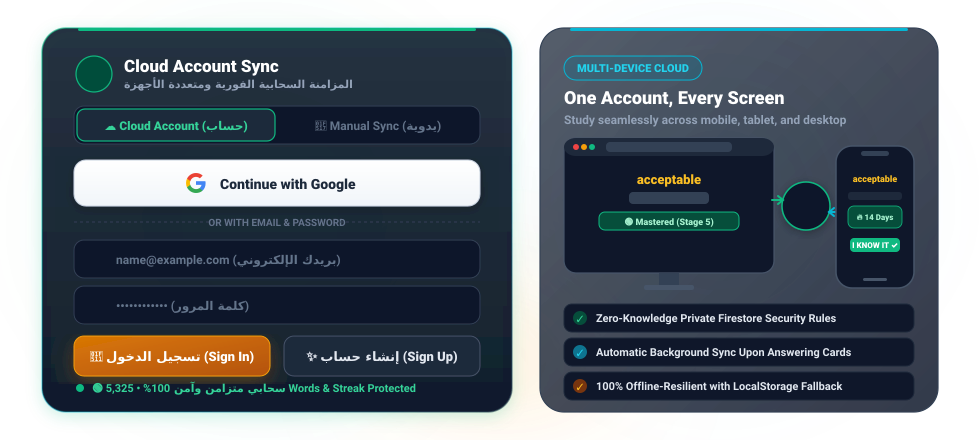
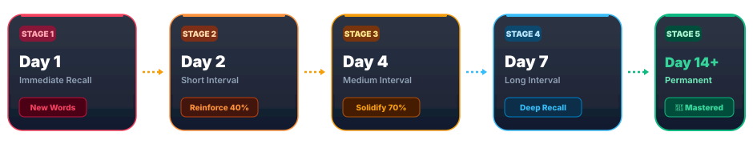
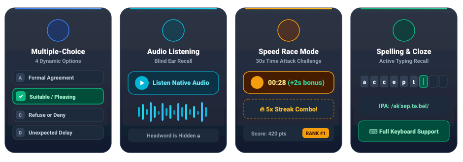

<div align="center">

# 🌟 Oxford 5000 Words
### 🎓 The Modern, Offline-First English Vocabulary Companion

[](https://sofyanol.github.io/oxford-5000-words/)
[](https://github.com/sofyanol/oxford-5000-words/releases/latest)
[](https://github.com/sofyanol/oxford-5000-words/stargazers)
[](https://www.paypal.com/ncp/payment/HZXA4F94TEA2A)

[](#)
[-teal?style=flat-square)](#)
[](#)
[](#)
[](#)
[-black?style=flat-square)](#)
[](LICENSE)

<br>

**A fast, private, distraction-free educational application built to master high-frequency English vocabulary through scientifically structured spaced repetition (SRS), authentic dual UK/US native audio, and active listening challenges.**

[🔗 **Open Live App**](https://sofyanol.github.io/oxford-5000-words/) • [✨ **What's New (1.4 & 1.5 Roadmap)**](#-whats-new-in-update-14--15-roadmap) • [🎯 **Features**](#-features-at-a-glance) • [🌐 **12 Languages**](#-supported-languages-12-locales) • [☕ **Support Project**](#-support-the-project)

<br><br>

<p align="center">
  <a href="https://sofyanol.github.io/oxford-5000-words/" title="Open Oxford 5000 Live Web App">
    
  </a>
</p>

<hr>
</div>

## 🌟 What's New in Update 1.5

<p align="center">
  <a href="https://sofyanol.github.io/oxford-5000-words/" title="Open Oxford 5000 Live Web App">
    
  </a>
</p>

Update 1.5 is a monumental milestone introducing secure multi-device cloud accounts, hands-free audio study, milestone badges, printable study sets, and atmospheric soundscapes:

* ☁️ **Cloud Account Sync & Multi-Device Authentication (Headline Feature)**:
  * **Seamless Google Sign-In & Email Authentication**: Sign in with one tap via Google (`Continue with Google`) or personal email/password to seamlessly back up and synchronize all your study progress, mastered vocabulary, and daily streak counts across mobile and desktop.
  * **Zero-Knowledge Privacy & Permanent Encryption**: Built with Google Firebase & Cloud Firestore security rules guaranteeing that every learner can only access their own private progress document.
  * **Realtime Cloud Indicator**: Live status badge (`🟢 Cloud Synced`) with automatic background synchronization upon answering cards.
  * **Alternative Zero-Login Manual Mode**: Preserves offline-first manual link sync and compact OX6 export codes for privacy-focused learners.

* 🎧 **Hands-Free Auto-Play Walk & Sleep Mode**: Eyes-free vocabulary listening engine for commuting, walking, or bedtime study with dual native pronunciations (UK/US), customizable pacing intervals (2.0s, 3.2s, 5.0s), and configurable sleep timer (15, 30, 45, 60 minutes).
* 🏆 **Gamification Badges & Milestone Achievements**: 10 distinct unlockable milestones celebrating study streaks, CEFR completion, quiz victories, and speed race achievements with celebratory confetti toasts.
* 🎯 **Smart Focus Deck (Leech Hunter)**: Automatically detects tricky vocabulary based on review lapses and missed quiz questions, enabling isolated one-click targeted focus drills.
* 🖨️ **Printable Study Sheets & Flashcards PDF**: Ink-friendly A4 print engine producing 3×3 cut-out flashcard grids with dashed cutting guides or structured vocabulary review tables.
* 🌧️ **Procedural Ambient Focus Soundscapes**: Pure Web Audio API soundscapes (Gentle Rain, Cozy Fireplace, Ocean Waves) running 100% offline with zero external audio dependencies.
* 📱 **Mobile Performance & Ergonomics**: Smooth 60fps rendering, elimination of floating button overlap, and tactile pill synchronization button.
* 💬 **In-App Private Feedback & Suggestion Center**: Submit vocabulary corrections, suggestions, or bug reports directly from inside the app with automatic card context tagging.
* 🎨 **Luxury OLED Pure Black & Sepia Themes**: True battery-saving OLED black (`#000000`) and eye-comfort warm classic sepia theme customizer in Settings.

<hr>

## 🎯 Features at a Glance

<p align="center">
  <a href="https://sofyanol.github.io/oxford-5000-words/" title="Open Oxford 5000 Live Web App">
    
  </a>
</p>

| Feature | Description |
| :--- | :--- |
| 📚 **5,325 Oxford Words** | Complete Oxford 3000 & Oxford 5000 dataset categorized across CEFR levels A1, A2, B1, B2, and C1. |
| 🔊 **Dual Native Audio** | 5,230 authentic UK (British) and US (American) native pronunciation recordings (10,460 files). |
| 📝 **100% Contextual Sentences** | Every single entry includes an authentic contextual example sentence. |
| 🧠 **Spaced Repetition (SRS)** | 5 scientifically structured review intervals (1d, 3d, 7d, 14d, 30d) for long-term memory retention. |
| 🎮 **4 Quiz Modes** | Standard Multiple Choice, Speed Race (Time Attack), Audio-Only Listening, and Interactive Spelling. |
| 📐 **Word Forms & Grammar** | Complete verb inflections (V1-V3, -ing, -s), noun plurals, and comparative/superlative adjectives. |
| 🔄 **Cloud & Offline Sync** | Instant Google & Email Cloud Sync, plus compact zero-login `OX6` binary sync links. |
| 🌐 **12 Global Languages** | Fully localized interface and word translations across 12 world languages. |
| ⚡ **Offline-First Build** | Fully self-contained single HTML release file that runs anywhere without internet. |

<p align="center">
  <a href="https://sofyanol.github.io/oxford-5000-words/" title="Open Oxford 5000 Live Web App">
    
  </a>
</p>

<hr>

## 🌐 Supported Languages (12 Locales)

Oxford 5000 is built for learners worldwide. Switch instantly between 12 localized interface and translation languages with a single click:

| Flag | Language | Native Name | Code |
| :---: | :--- | :--- | :---: |
| 🇬🇧 | **English** | English | `en` |
| 🇸🇦 | **Arabic** | العربية | `ar` |
| 🇪🇸 | **Spanish** | Español | `es` |
| 🇫🇷 | **French** | Français | `fr` |
| 🇩🇪 | **German** | Deutsch | `de` |
| 🇵🇹 | **Portuguese** | Português | `pt` |
| 🇷🇺 | **Russian** | Русский | `ru` |
| 🇹🇷 | **Turkish** | Türkçe | `tr` |
| 🇵🇰 | **Urdu** | اردو | `ur` |
| 🇮🇳 | **Hindi** | हिन्दी | `hi` |
| 🇮🇩 | **Indonesian** | Bahasa Indonesia | `id` |
| 🇨🇳 | **Chinese** | 中文 | `zh` |

<hr>

## ☕ Support the Project

If Oxford 5000 helps you learn English, prepare for exams (IELTS, TOEFL, Cambridge), or teach students, please consider supporting its ongoing development and maintenance!

<div align="center">

[](https://www.paypal.com/ncp/payment/HZXA4F94TEA2A)

[](https://www.paypal.com/ncp/payment/HZXA4F94TEA2A)

*Your contributions help keep this project 100% free, privacy-first, and ad-free.*

</div>

<hr>

## 📜 Previous Release Highlights

<details>
<summary><b>🔥 Update 1.4 — Spaced Habits, Spelling Quiz &amp; Word Match</b></summary>
<br>

- **Daily Study Habit, Goals &amp; Streak Counter**: Track daily study streaks in `localStorage`, set daily card targets (10, 20, 50, or 100), and celebrate reaching goals with confetti.
- **Audio Playback Speed &amp; Auto-Pronounce**: Toggle audio speeds (`1.0x`, `0.8x`, `0.6x`) on pronunciation buttons for clear slow articulation.
- **Interactive Spelling &amp; Writing Quiz Mode**: Test active recall by listening to audio, reading contextual cloze sentences, and typing the missing word with phonetic IPA hints.
- **Fast-Paced Word Match Challenge**: Engaging memory-match mini-game against a 45s timer with Web Audio sound effects and combo multipliers.
- **Visual Learning Analytics &amp; CEFR Radar**: Interactive SVG pentagon radar chart tracking CEFR levels (A1-C1) and Leitner SRS distribution.
- **One-Click Export to Anki (TSV)**: Export Unknown words, Due reviews, or custom sets into Anki-ready TSV files with standard import headers.
- **Progressive Web App (PWA) Offline Support**: Installable on desktop and mobile with `manifest.webmanifest` and cache-first `sw.js`.
</details>

<details>
<summary><b>⚡ Update 1.3 — Speed Race, Listening Quiz &amp; Word Explorer</b></summary>
<br>

- **Speed Race Mode (Time Attack)**: 30-second rapid vocabulary recall quiz with +2s time bonus per correct answer and animated float badges.
- **Audio-Only Listening Quiz Mode**: Ear-training mode without seeing written text, testing pure auditory recognition.
- **Smart Word Explorer &amp; Advanced Search**: 8 sorting algorithms (A-Z, CEFR, Due, Frequency) and category filter chips.
- **Custom Word, Sentence, and Forms Editor**: Personalize definitions, examples, and translations locally in browser storage.
- **Floating "What's New" Star Badge &amp; Complete Written Site Guide**: 3-tab modal with site guide, release notes, and cumulative changelog.
</details>

<details>
<summary><b>📦 Update 1.2 — Full Dataset &amp; Native Dual Pronunciation</b></summary>
<br>

- Expanded vocabulary dataset to **5,325 Oxford entries** with unique `id` primary keys.
- Mapped **5,230 entries to authentic UK and US native MP3 recordings**.
- Dedicated example sentence for every single entry (100% coverage).
- Added Dutch language support and compact multilingual project-support button.
</details>

<details>
<summary><b>🧭 Update 1.1 — Guided Tutorial & Word Forms Guide</b></summary>
<br>

- Added 5-step guided interactive tutorial explaining cards, progress, quizzes, and language.
- Added dedicated word-form explanation modal detailing grammatical inflections.
- Improved modal viewport safety and touch controls on mobile devices.
</details>

<details>
<summary><b>🌱 Update 1.0 — Initial Release</b></summary>
<br>

- Initial launch with 4,954 Oxford words, SRS algorithm, and serverless OX6 sync.
</details>

<hr>

## 🚀 Try It Online & Run Locally

### 🌐 Live Web App
Open directly in any modern browser:  
👉 **[https://sofyanol.github.io/oxford-5000-words/](https://sofyanol.github.io/oxford-5000-words/)**

### 💻 Run Locally
Requirements: **Python 3.8+** (Zero Node.js or npm dependencies required).

```powershell
# Build standalone HTML bundle
python build\build.py
```

The output file is:
```text
dist\oxford5000-flashcards-final.html
```
Open it directly in Chrome, Firefox, Safari, or Edge.  
To run automated in-browser self-tests, open `dist\oxford5000-flashcards-final.html#selftest` and verify `SELFTEST PASS` in the console.

### 🚢 Deploy to GitHub Pages
1. Run `python build\build.py`.
2. Push your changes to `master` or `main`.
3. The built-in GitHub Actions workflow (`.github/workflows/pages.yml`) will automatically deploy the site.

<hr>

## 📁 Project Structure

```text
oxford5000-app/
├─ src/                      HTML structure, modern CSS styles, and application logic
├─ data/                     5,325 words, IPA, translations, and forms dataset
├─ audio/                    5,230 UK and 5,230 US native Oxford pronunciation files
├─ build/build.py            Single-command standalone HTML release builder
├─ dist/                     Generated release files (single-file distribution)
├─ publish/                  Publishing deployment files
├─ docs/                     Architecture, data guidelines, and changelogs
├─ ALL_UPDATES_CHANGELOG.md  Master historical changelog from 1.0 to 1.5
├─ RELEASE_NOTES_v1.6.md     Dedicated 1.5 release notes (In Development)
└─ RELEASE_NOTES_v1.4.md     Dedicated 1.4 release notes
```

<hr>

## 🤝 Contributing & Community

Contributions that improve vocabulary accuracy, phonetic transcriptions, translations, and learning accessibility are warmly welcomed:
- 💡 **Found a typo or better translation?** Open an issue or submit a pull request!
- ⭐ **Star this repository** to help other language learners discover it.
- 📢 **Share with friends and classmates** who are learning English.

See [CONTRIBUTING.md](CONTRIBUTING.md) for contribution guidelines.

<hr>

## ⚖️ License & Data Attribution

- Code is released under the **[MIT License](LICENSE)**.
- Oxford word lists belong to Oxford University Press. This project is an independent educational tool created for personal learning. See [NOTICE.md](NOTICE.md) for data distinctions.
