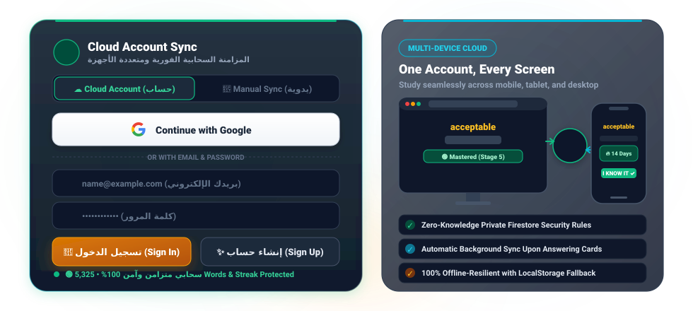

# Oxford 5000 Words - Release Notes v1.5.0

## Overview
Update 1.5.0 is a milestone release delivering **Cloud Account Sync & Multi-Device Authentication** alongside an unprecedented offline-first study and focus suite: **Hands-Free Auto-Play Walk & Sleep Mode**, **Gamification Badges & Milestone Achievements**, **Smart Focus Deck / Leech Hunter**, **Printable Study Sheets & Cut-out Flashcards PDF**, **Procedural Ambient Focus Soundscapes via Web Audio API**, **Luxury OLED Pure Black & Warm Classic Sepia Themes**, and a **Hardened Code Quality & Security Audit** ensuring 100% glitch-free performance.

---

## What's New in Version 1.5.0

### 1. ☁️ Cloud Account Sync & Multi-Device Authentication (Headline Feature)

  

- **Seamless Google Sign-In & Email Authentication**: Sign in with one tap via Google (`Continue with Google`) or personal email/password to seamlessly back up and synchronize all your study progress, mastered vocabulary, and daily streak counts across mobile and desktop.
- **Zero-Knowledge Privacy & Permanent Encryption**: Built with Google Firebase & Cloud Firestore security rules guaranteeing that every learner can only access their own private progress document.
- **Realtime Cloud Indicator**: Live status badge (`🟢 Cloud Synced`) with automatic background synchronization upon answering cards.
- **Alternative Zero-Login Manual Mode**: Preserves offline-first manual link sync and compact OX6 export codes for privacy-focused learners.
- **Tactile Pill Synchronization Button**: Streamlined top bar sync pill (`stat-pill sync-pill`) perfectly matched with the habit streak counter.

### 2. 🎧 Hands-Free Auto-Play Walk & Sleep Mode
- **Eyes-Free Vocabulary Acquisition**: Study on the go while walking, exercising, commuting, or relaxing in bed without touching the screen.
- **Dual Pronunciation Pacing**: Configurable audio sequence (British English UK, American English US, or sequential UK followed by US).
- **Customizable Interval Timer**: Pacing speed selectors (2.0s Fast, 3.2s Normal, 5.0s Relaxed) with smooth progress bar animation.
- **Sleep Timer (🌙)**: Automatically stops playback after 15, 30, 45, or 60 minutes with graceful audio termination.

### 2. 🏆 Gamification Badges & Milestone Achievements (10 Badges)
- **10 Distinct Unlockable Milestones**:
  1. 🌱 **First Step**: Master your very first vocabulary word.
  2. 🧭 **Curious Mind**: Explore and review 50+ unique words.
  3. 🔥 **Habit Builder**: Reach a 3-day consecutive study streak.
  4. ⚡ **Week Warrior**: Maintain an unbroken 7-day study streak.
  5. 🎯 **Quiz Master**: Score 100% on a multiple-choice quiz.
  6. 🏎️ **Speed Racer**: Score 15+ correct answers in Speed Race Mode.
  7. ✍️ **Orthographer**: Complete a spelling quiz with 100% accuracy.
  8. 🧩 **Memory Champ**: Clear a Word Match game board under 45 seconds.
  9. 🌍 **CEFR Conqueror**: Learn words spanning across all 5 CEFR levels (A1 to C1).
  10. 👑 **Century Scholar**: Master 100+ words in Leitner SRS Review Stage 5.
- **Celebratory Real-Time Toasts**: Non-intrusive achievement toast banners with custom icons, gold trim, and celebratory confetti.
- **Interactive Badge Showcase**: Dedicated modal displaying overall unlock percentage and individual badge details.

### 3. 🎯 Smart Focus Deck / Leech Hunter
- **Automated Weak-Spot Identification**: Intelligently identifies and isolates words marked unknown or missed during quiz sessions.
- **One-Click Focused Drill**: Instantly loads tricky words into an exclusive study deck so learners can conquer difficulties in targeted review sessions.
- **Lapse Counter & Management**: Real-time count of learning lapses per word with option to clear or repopulate.

### 4. 🖨️ Printable Study Sheets & Cut-Out Flashcards PDF
- **Ink-Friendly Offline Learning**: Generate formatted printable study sheets or paper flashcard cut-out grids for screen-free study.
- **Two Layout Options**:
  - **Cut-Out Flashcard Grid (3×3)**: Standard pocket flashcards with dashed cutting guidelines.
  - **Structured Revision Table**: Clean, high-density study tables for quick reference.
- **Source Filtering & Customization**: Print current filter deck, bookmarked words, tricky words, or specific CEFR levels (A1-C1) with toggles for IPA phonetics, translation, and example sentences.

### 5. 🌧️ Ambient Focus Soundscapes (Pure Web Audio API)
- **Zero External Audio Files (100% Procedural)**: Synthesized directly inside the browser using Web Audio API nodes with 0 network overhead.
- **Three Calming Soundscapes**:
  - 🌧️ **Gentle Rain**: Soothing pink noise filtered through resonant lowpass filters simulating rainfall.
  - 🔥 **Cozy Fireplace**: Ambient low rumbling background with randomized crackling bursts and wood pop impulses.
  - 🌊 **Ocean Waves**: Deep tidal swells modulated by a slow sinusoidal low-frequency oscillator.
- **Integrated Mixer**: Individual volume controls and master volume slider with mute toggle.

### 6. 🎨 Luxury OLED Pure Black & Warm Classic Sepia Themes
- **Personalized Visual Ergonomics**: Selectable from the Settings panel and persisted in `localStorage`.
- **Three Curated Themes**:
  - **Midnight Navy & Gold (Default)**: Deep midnight obsidian backdrop with glowing gold accents.
  - **OLED Pure Black**: 100% `#000000` pitch black background designed to maximize battery life on OLED/AMOLED mobile screens.
  - **Warm Classic Sepia**: Warm parchment and earth-toned sepia palette crafted for nighttime reading comfort.

### 7. 🛡️ Hardened Code Quality & Security Verification
- **Automated Quality Audit Tool (`tools/audit_code_quality.py`)**:
  - 100% balanced markup and stylesheet braces (900 CSS rule blocks).
  - 0 `eval()`, 0 dynamic `Function()`, and 0 `document.write()`.
  - Comprehensive `localStorage` safety with 71 try/catch error boundaries.
  - 100% i18n translation key parity across all 12 supported languages.
- **Autonomous Release Trigger**: Fully compatible with `publish_and_bump.py --publish` for seamless continuous deployment.

---

## Technical Specifications
- **Build Output**: Standalone single-file HTML bundle (`dist/oxford5000-flashcards-final.html` and `publish/index.html`).
- **External Dependencies**: 0 npm packages, 0 Node.js build tools, 0 CDN scripts.
- **Vocabulary Dataset**: 5,325 curated words across CEFR levels A1-C1.
- **Native Audio**: 10,460 local recordings (5,230 UK + 5,230 US).
- **Supported Locales**: 12 languages (`en`, `ar`, `es`, `fr`, `de`, `pt`, `ru`, `tr`, `ur`, `hi`, `id`, `zh`).
- **PWA Service Worker Cache**: `oxford5000-v1.5.0`.
